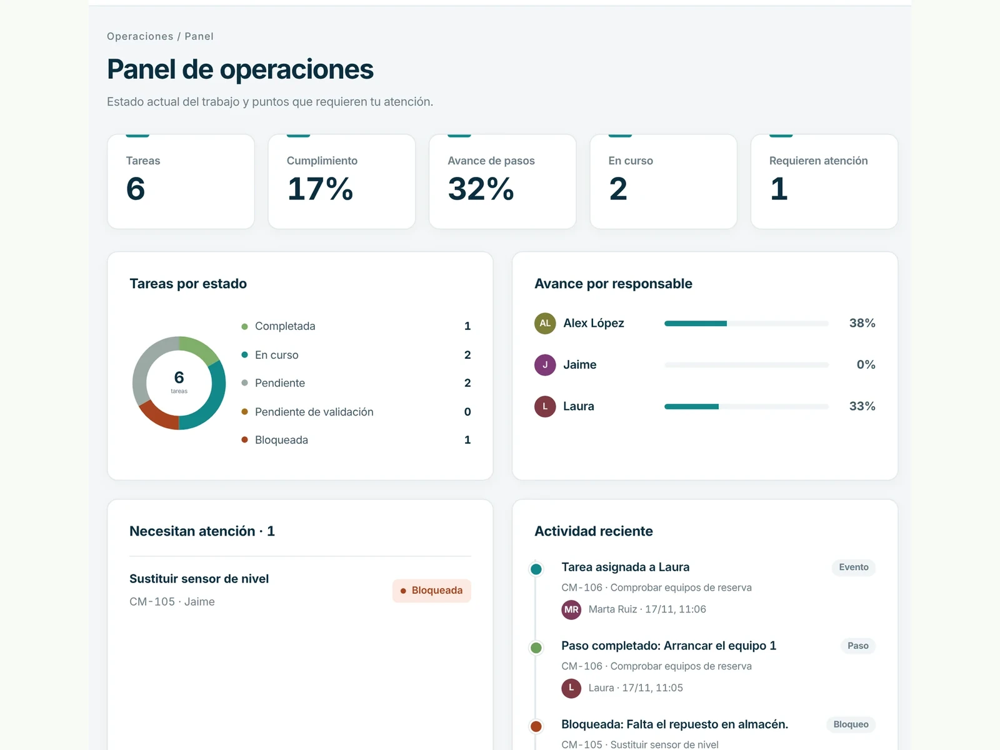
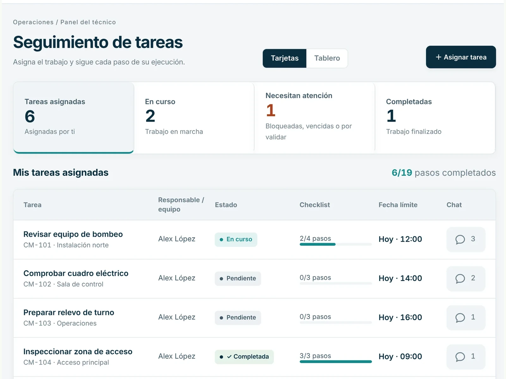
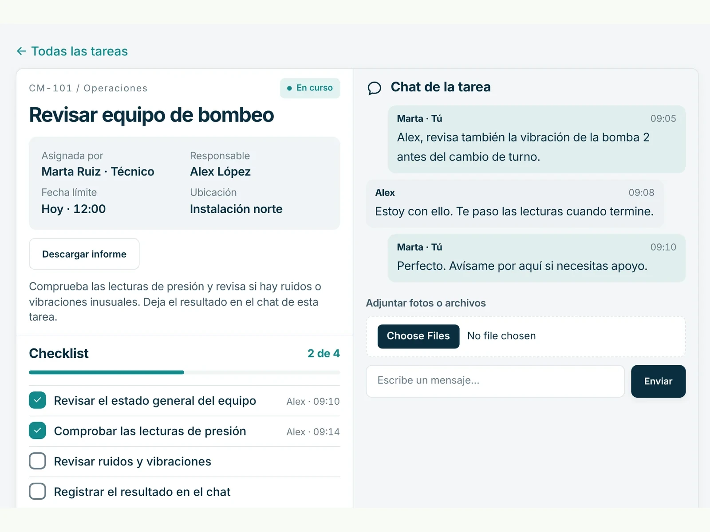

<picture>
  <source media="(prefers-color-scheme: dark)" srcset="assets/brand/crewmoor-logo-white.svg" />
  
</picture>

<strong>Operations, maintenance and asset management</strong>

  <a href="https://www.crewmoor.com/">Website</a> ·
  <a href="https://demo.crewmoor.com/">Interactive prototype</a> ·
  <a href="https://contactme.crewmoor.com/">Contact</a>

Product showcase · In development

---

## Overview

Crewmoor is a platform in development for companies that operate and maintain physical assets. I’m designing it to connect work reported in the field, maintenance tasks and the history of each piece of equipment.

When a technician finds a fault during a round, the next shift needs to know which asset was affected, what was checked and what still needs attention. Crewmoor already supports real-time chat within tasks. The goal is to make those decisions part of the asset’s maintenance history, so teams can refer back to them when the same fault returns.

> [!IMPORTANT]
> Crewmoor is **under development** and is **not a commercially available service**. The [interactive prototype](https://demo.crewmoor.com/) runs in the browser on sample data. It is not connected to a production backend, and nothing you do in it is saved.

## Screenshots

These screenshots are from the interactive prototype and show sample data. The interface language is Spanish.

<table>
  <tr>
    <td width="50%"></td>
    <td width="50%"></td>
  </tr>
  <tr>
    <td><strong>Operations dashboard:</strong> status breakdown, progress by assignee and recent activity.</td>
    <td><strong>Task tracking:</strong> assignee, status, checklist progress and deadlines at a glance.</td>
  </tr>
</table>

<strong>Task detail:</strong> checklist steps with who completed them and when, plus a chat for that task.

## Core functionality

Every area below can be explored in the prototype. None of them is available yet as a production feature.

| Area | What it covers |
| --- | --- |
| **Teams and workspaces** | Organise people into teams and give each member a clear set of responsibilities. |
| **Task assignment** | Create tasks with an assignee, a location, a deadline and a step-by-step checklist. |
| **Operations dashboard** | Task counts, completion rate, tasks by status and progress per assignee. |
| **Activity tracking** | A timeline of assignments, completed steps and blocked tasks. |
| **Calendar and deadlines** | Upcoming work and due dates in a calendar view. |
| **Team communication** | A chat for each task, so conversations stay attached to the work they concern. |
| **Reports and exports** | Task reports with PDF, Excel and CSV export options. |

## Development status

| Component | Status |
| --- | --- |
| Product concept and interface design | Explored through the interactive prototype |
| [Interactive prototype](https://demo.crewmoor.com/) | Public, browser-only, uses sample data |
| [Website](https://www.crewmoor.com/) | Public product introduction (English and Spanish) |
| Backend application | Early development in Java and Spring Boot (private repository) |
| Production service | Not available |

## Roadmap

The roadmap shows direction, not release dates. Items may change, be postponed or be dropped as the product develops.

**In progress**

- Backend foundation: task domain model, authentication and the messaging infrastructure for real-time updates.
- Refining the prototype's navigation, consistency and layouts on mobile and desktop.

**Planned**

- Connecting the interface to the backend, with persistent storage.
- Connecting asset records, reported issues and maintenance tasks so teams can trace the history of an intervention.
- Generating reports and exports from real workspace data.
- Gathering feedback from people who try the prototype.

More detail: [Product overview](docs/PRODUCT_OVERVIEW.md) · [Roadmap](docs/ROADMAP.md)

## About this repository

This is the **public showcase** for Crewmoor. It contains the product description, documentation, official brand assets and prototype screenshots.

The application's source code, deployment configuration, credentials and internal materials are **not** included, and this repository is not an open-source release. The Crewmoor name and logo are original brand assets. Please do not reuse or modify them.

## Author

Crewmoor is designed and developed by **Francisco González Álvarez**, a software developer working mainly in Java and Spring Boot.

[GitHub](https://github.com/FranciscoGoal) · [LinkedIn](https://www.linkedin.com/in/francisco-galvarez) · [crewmoor.com](https://www.crewmoor.com/)

© 2026 Crewmoor. All rights reserved.
